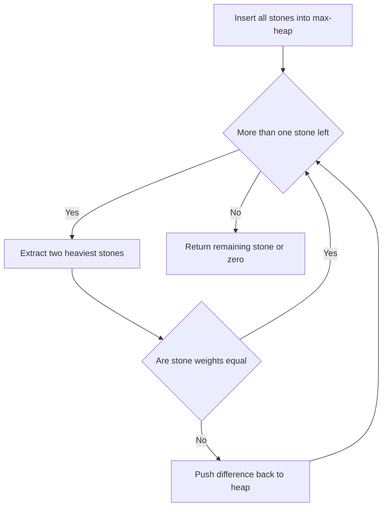

<h2><a href="https://leetcode.com/problems/last-stone-weight">1046. Last Stone Weight</a></h2>

<p>You are given an array of integers <code>stones</code> where <code>stones[i]</code> is the weight of the <code>i<sup>th</sup></code> stone.</p>

<p>We are playing a game with the stones. On each turn, we choose the <strong>heaviest two stones</strong> and smash them together. Suppose the heaviest two stones have weights <code>x</code> and <code>y</code> with <code>x &lt;= y</code>. The result of this smash is:</p>

<ul>
	<li>If <code>x == y</code>, both stones are destroyed, and</li>
	<li>If <code>x != y</code>, the stone of weight <code>x</code> is destroyed, and the stone of weight <code>y</code> has new weight <code>y - x</code>.</li>
</ul>

<p>At the end of the game, there is <strong>at most one</strong> stone left.</p>

<p>Return <em>the weight of the last remaining stone</em>. If there are no stones left, return <code>0</code>.</p>

<p>&nbsp;</p>
<p><span class="float-right -my-0.5 ml-2 inline-flex select-none items-center" data-example-lang-controls=""><span role="group" class="inline-flex h-6 items-center rounded-sd-md bg-sd-muted p-0.5" data-example-lang-toggle=""><button type="button" aria-pressed="true" class="h-5 max-w-[10rem] truncate whitespace-nowrap rounded-sd-sm border px-2 text-xs font-normal leading-none border-sd-border bg-sd-background text-sd-foreground" fdprocessedid="s4p3zzm">Original</button><button type="button" aria-pressed="false" class="h-5 max-w-[10rem] truncate whitespace-nowrap rounded-sd-sm border px-2 text-xs font-normal leading-none border-transparent text-sd-muted-foreground hover:text-sd-foreground" fdprocessedid="0asloo">Java</button></span></span><strong class="example">Example 1:</strong></p>

<pre><strong>Input:</strong> stones = [2,7,4,1,8,1]
<strong>Output:</strong> 1
<strong>Explanation:</strong> 
We combine 7 and 8 to get 1 so the array converts to [2,4,1,1,1] then,
we combine 2 and 4 to get 2 so the array converts to [2,1,1,1] then,
we combine 2 and 1 to get 1 so the array converts to [1,1,1] then,
we combine 1 and 1 to get 0 so the array converts to [1] then that's the value of the last stone.
</pre>

<p><strong class="example">Example 2:</strong></p>

<pre><strong>Input:</strong> stones = [1]
<strong>Output:</strong> 1
</pre>

<p>&nbsp;</p>
<p><strong>Constraints:</strong></p>

<ul>
	<li><code>1 &lt;= stones.length &lt;= 30</code></li>
	<li><code>1 &lt;= stones[i] &lt;= 1000</code></li>
</ul>


---

# 🛍️ Last-Stone-Weight | Explained

## Approach 1: Max-Heap Simulation
### Intuition
Imagine a tournament bracket where only the two heaviest competitors fight each round. When they clash, they either destroy each other completely if they are evenly matched, or the heavier one survives with its weight reduced by the opponent's weight. 

To simulate this process efficiently, we constantly need quick access to the two largest numbers. While re-sorting an array after every collision would be slow, a Max-Priority Queue (Max-Heap) naturally keeps the largest elements at the top in logarithmic time.

### Algorithm Visualized


### Approach
1. **Initialize Max-Heap:** Create a priority queue ordered in descending order so the largest stones are always popped first.
2. **Populate Heap:** Insert every stone from the input array into the heap.
3. **Smash Stones:** While the heap contains at least two stones:
   - Extract the heaviest stone ($x$) and the second heaviest stone ($y$).
   - If their weights differ ($x \ne y$), calculate the remaining piece ($x - y$) and push it back into the heap.
   - If they are equal, both are destroyed and nothing is pushed back.
4. **Return Result:** When at most one stone remains, return its weight if the heap is not empty, otherwise return `0`.

### Detailed Code Analysis
**Heap Construction (Lines 3-6):**  
A Java `PriorityQueue` is a min-heap by default, so `Collections.reverseOrder()` is passed to convert it into a max-heap. The loop iterates through `stones`, pushing each element into queue `a`. Each insertion costs $O(\log n)$.

**Simulation Loop (Lines 7-13):**  
The `while (a.size() > 1)` condition ensures there are at least two stones to smash. The two heaviest stones are retrieved using consecutive pairs of `peek()` and `poll()`. Since $x$ was removed first from a max-heap, $x \ge y$ is guaranteed. If $x \ne y$, the difference `x - y` is pushed back, automatically bubbling to its correct sorted position in $O(\log n)$ time.

**Terminal Check (Lines 14-16):**  
After the loop finishes, the queue holds either zero stones (if all pairs eliminated each other) or exactly one stone. The boundary check `if (a.size() == 0)` handles the empty case safely before calling `a.peek()`.

### Code
```java
class Solution {
    public int lastStoneWeight(int[] stones) {
        PriorityQueue<Integer> a = new PriorityQueue<>(Collections.reverseOrder());
        for (int i = 0; i < stones.length; i++) {
            a.add(stones[i]);
        }
        while (a.size() > 1) {
            int x = a.peek();
            a.poll();
            int y = a.peek();
            a.poll();
            if (x != y) a.add(x - y);
        }
        if (a.size() == 0) return 0;
        return a.peek();
    }
}
```

### Complexity
- **Time:** $O(n \log n)$  
  - Inserting $n$ stones individually takes $O(n \log n)$.  
  - Each clash operation removes two elements and inserts at most one, reducing the total stone count by at least 1 per iteration. There are at most $n - 1$ collisions, each requiring $O(\log n)$ heap operations.
- **Space:** $O(n)$  
  - The priority queue stores up to $n$ stone weights simultaneously.

---

## 🕵️‍♂️ Follow-up Questions (Optional)

1. **Can we achieve $O(n)$ time complexity if the stone weights are small?**  
   Yes. If the maximum stone weight $W$ is small (e.g., $W \le 1000$), we can use a **Bucket Array / Counting Sort** approach. We maintain frequency counts for each weight and iterate backwards from $W$, simulating the clashes without the $O(\log n)$ heap overhead.

2. **Can the code structure for extraction be cleaner?**  
   Yes. Calling `a.peek()` followed immediately by `a.poll()` is redundant. `a.poll()` both retrieves and removes the head in a single step (`int x = a.poll(); int y = a.poll();`), reducing method call overhead and improving readability.