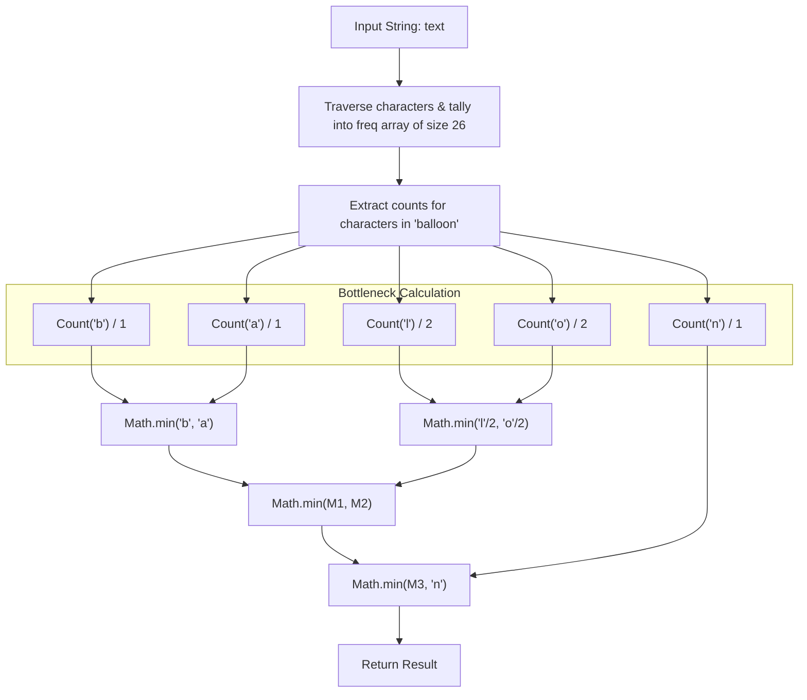

<h2><a href="https://leetcode.com/problems/maximum-number-of-balloons">1189. Maximum Number of Balloons</a></h2>

<p>Given a string <code>text</code>, you want to use the characters of <code>text</code> to form as many instances of the word <strong>"balloon"</strong> as possible.</p>

<p>You can use each character in <code>text</code> <strong>at most once</strong>. Return the maximum number of instances that can be formed.</p>

<p>&nbsp;</p>
<p><strong class="example">Example 1:</strong></p>

<p><strong></strong></p>

<pre><strong>Input:</strong> text = "nlaebolko"
<strong>Output:</strong> 1
</pre>

<p><strong class="example">Example 2:</strong></p>

<p><strong></strong></p>

<pre><strong>Input:</strong> text = "loonbalxballpoon"
<strong>Output:</strong> 2
</pre>

<p><strong class="example">Example 3:</strong></p>

<pre><strong>Input:</strong> text = "leetcode"
<strong>Output:</strong> 0
</pre>

<p>&nbsp;</p>
<p><strong>Constraints:</strong></p>

<ul>
	<li><code>1 &lt;= text.length &lt;= 10<sup>4</sup></code></li>
	<li><code>text</code> consists of lower case English letters only.</li>
</ul>

<p>&nbsp;</p>
<p><strong>Note:</strong> This question is the same as <a href="https://leetcode.com/problems/rearrange-characters-to-make-target-string/description/" target="_blank"> 2287: Rearrange Characters to Make Target String.</a></p>


---

# 🛍️ Maximum-Number-of-Balloons | Explained

## Approach 1: Frequency Array with Bottleneck (Limiting Reagent) Analysis

### Intuition
Think of this problem like baking cakes where each cake requires a specific recipe. To assemble one instance of the word **`"balloon"`**, you need a fixed set of ingredients:
- $1$ unit of `'b'`
- $1$ unit of `'a'`
- $2$ units of `'l'`
- $2$ units of `'o'`
- $1$ unit of `'n'`

No matter how many extra `'b'`s or `'a'`s you have, your production line stops as soon as you run out of any single required letter. In chemistry and manufacturing, this is known as the **limiting reagent** or **bottleneck**. 

Because `'l'` and `'o'` appear twice in the word `"balloon"`, each complete word consumes two of each. Therefore, if you have $5$ `'l'`s, you can only make $\lfloor 5 / 2 \rfloor = 2$ balloons. The maximum number of words you can form is strictly bounded by the minimum availability across all five required characters.

---

### Algorithm Visualized



---

### Approach
1. **Frequency Counting**:
   - Create a fixed-size integer array of length $26$ representing the English lowercase alphabet.
   - Iterate through every character of the input string `text`, incrementing the index corresponding to `ch - 'a'`.
2. **Account for Multiplicities**:
   - For letters required once (`'b'`, `'a'`, `'n'`), the available instances equal their raw frequency count.
   - For letters required twice (`'l'`, `'o'`), the available instances equal `freq / 2`. Integer division automatically truncates remainders (e.g., $3 / 2 = 1$).
3. **Determine the Bottleneck**:
   - Compute the cumulative minimum of all five quantities using nested `Math.min()` calls.
   - Return this minimum value as the maximum number of times `"balloon"` can be formed.

---

### Detailed Code Analysis

```java
int[] freq = new int[26];
```
- A fixed-size array of size $26$ is allocated to store the counts of characters from `'a'` to `'z'`. 
- Using an array indexed by character offsets (`ch - 'a'`) is substantially faster than a `HashMap<Character, Integer>` because it avoids boxing/unboxing overhead, hashing, and pointer dereferencing, operating in continuous $O(1)$ cache-friendly memory.

```java
for (char ch : text.toCharArray()) {
    freq[ch - 'a']++;
}
```
- Converts the string to a character array and iterates sequentially over each character.
- `ch - 'a'` calculates the zero-based index of the character (e.g., `'a' - 'a' = 0`, `'b' - 'a' = 1`).
- The corresponding index in `freq` is incremented.

```java
return Math.min(
    Math.min(
        Math.min(freq['b' - 'a'], freq['a' - 'a']),
        Math.min(freq['l' - 'a'] / 2, freq['o' - 'a'] / 2)
    ),
    freq['n' - 'a']
);
```
- Computes the minimum available sets across all required characters:
  - `freq['b' - 'a']`: instances of `'b'`
  - `freq['a' - 'a']`: instances of `'a'`
  - `freq['l' - 'a'] / 2`: instances of `'l'`, halved due to duplicate requirement.
  - `freq['o' - 'a'] / 2`: instances of `'o'`, halved due to duplicate requirement.
  - `freq['n' - 'a']`: instances of `'n'`
- Nested `Math.min` functions evaluate pairwise to yield the global minimum among the five components.

---

### Code

```java
class Solution {
    public int maxNumberOfBalloons(String text) {
        int[] freq = new int[26];
        for (char ch : text.toCharArray()) {
            freq[ch - 'a']++;
        }
        return Math.min(
            Math.min(
                Math.min(freq['b' - 'a'], freq['a' - 'a']),
                Math.min(freq['l' - 'a'] / 2, freq['o' - 'a'] / 2)
            ),
            freq['n' - 'a']
        );       
    }
}
```

---

### Complexity

- **Time Complexity:** $\mathcal{O}(N)$
  - Let $N$ be the length of the string `text`.
  - Iterating over `text.toCharArray()` takes $\mathcal{O}(N)$ time.
  - The nested `Math.min()` operations operate on a fixed number of lookups ($5$ characters), taking $\mathcal{O}(1)$ time.
  - Total Time: $\mathcal{O}(N)$.

- **Space Complexity:** $\mathcal{O}(1)$ Auxiliary Space (or $\mathcal{O}(N)$ temporary allocation)
  - The frequency table `freq` has a fixed length of $26$, which requires $\mathcal{O}(1)$ auxiliary space.
  - *Note on Java Implementation:* `text.toCharArray()` creates a duplicate array copy of `text` of size $N$, temporarily requiring $\mathcal{O}(N)$ heap memory. To achieve strict $\mathcal{O}(1)$ memory without allocating an array copy, replace the loop with:
    ```java
    for (int i = 0; i < text.length(); i++) {
        freq[text.charAt(i) - 'a']++;
    }
    ```

---

## 🕵️‍♂️ Follow-up Questions (Optional)

1. **How would you generalize this solution to support any arbitrary target word (not just `"balloon"`)?**
   - Instead of hardcoding the bottleneck logic, build two frequency maps: one for the target word (`targetFreq`) and one for the text (`textFreq`). Then iterate through each unique character in `targetFreq` and compute $\min(\lfloor \text{textFreq}[c] / \text{targetFreq}[c] \rfloor)$.

2. **What if the input is a massive continuous stream of characters that does not fit in memory?**
   - You do not need to store the string. Read characters one by one directly from the stream into the 26-element array (or an array of only the 5 required characters), then apply the exact same bottleneck formula when the stream terminates. This maintains $\mathcal{O}(1)$ working memory throughout the entire process.