<h2><a href="https://leetcode.com/problems/remove-nth-node-from-end-of-list">19. Remove Nth Node From End of List</a></h2>

<p>Given the <code>head</code> of a linked list, remove the <code>n<sup>th</sup></code> node from the end of the list and return its head.</p>

<p>&nbsp;</p>
<p><strong class="example">Example 1:</strong></p>

<pre><strong>Input:</strong> head = [1,2,3,4,5], n = 2
<strong>Output:</strong> [1,2,3,5]
</pre>

<p><strong class="example">Example 2:</strong></p>

<pre><strong>Input:</strong> head = [1], n = 1
<strong>Output:</strong> []
</pre>

<p><strong class="example">Example 3:</strong></p>

<pre><strong>Input:</strong> head = [1,2], n = 1
<strong>Output:</strong> [1]
</pre>

<p>&nbsp;</p>
<p><strong>Constraints:</strong></p>

<ul>
	<li>The number of nodes in the list is <code>sz</code>.</li>
	<li><code>1 &lt;= sz &lt;= 30</code></li>
	<li><code>0 &lt;= Node.val &lt;= 100</code></li>
	<li><code>1 &lt;= n &lt;= sz</code></li>
</ul>

<p>&nbsp;</p>
<p><strong>Follow up:</strong> Could you do this in one pass?</p>


---

# 🛍️ Remove-Nth-Node-From-End-of-List | Explained

## Approach 1: One-Pass Two-Pointer (Fixed-Gap Technique with Dummy Node)

### Intuition
Imagine two runners on a straight track, Runner A (Fast) and Runner B (Slow). If you give Runner A an exact head start of $n$ steps and then have both runners move forward at the exact same pace, the distance between them will always remain $n$ steps. 

When Runner A crosses the finish line (the `null` pointer at the end of the list), Runner B will be located exactly $n$ steps behind the finish line. By starting Runner B at a synthetic **Dummy Node** placed right before the actual head of the list, Runner B conveniently stops at the node **immediately preceding** the node you need to delete. This allows for an instantaneous removal in a single pass without needing to count the total length of the list first.

### Algorithm Visualized

```mermaid
flowchart TD
    subgraph Initial State ["1. Initialize Dummy Node & Pointers"]
        direction LR
        D["res/dummy (0)"] --> N1["1 (head)"] --> N2["2"] --> N3["3"] --> N4["4"] --> N5["5"] --> NULL1["null"]
    end

    subgraph Fast Forward ["2. Advance Fast Pointer ('head') by n = 2 steps"]
        direction LR
        D2["dummy (0)"] --> N1_2["1"] --> N2_2["2"] --> N3_2["3 (head)"] --> N4_2["4"] --> N5_2["5"] --> NULL2["null"]
    end

    subgraph Simultaneous Advance ["3. Move Both Pointers until Fast ('head') reaches null"]
        direction LR
        D3["(0)"] --> N1_3["1"] --> N2_3["2"] --> N3_3["3 (dummy)"] --> N4_3["4 (Target)"] --> N5_3["5"] --> NULL3["null (head)"]
    end

    subgraph Deletion ["4. Bypass Target Node (dummy.next = dummy.next.next)"]
        direction LR
        N3_4["3 (dummy)"] -- "bypasses 4" --> N5_4["5"]
    end
```



### Approach
1. **Initialize a Sentinel (Dummy) Node**: Create a node `res` pointing to the `head` of the list. This standardizes edge cases (e.g., removing the very first node of the list or handling a list of length 1).
2. **Assign Slow Pointer**: Set pointer `dummy` at the sentinel node.
3. **Establish Gap**: Advance the `head` reference (acting as the fast pointer) forward by $n$ steps. Now, the gap between `head` and `dummy` is $n + 1$ nodes.
4. **Slide the Window**: Move both `head` and `dummy` forward one node at a time until `head` reaches `null`.
5. **Delete Target Node**: The `dummy` pointer will now be pointing directly to the node preceding the target. Update `dummy.next = dummy.next.next` to remove the $n$-th node from the end.
6. **Return Result**: Return `res.next`, which is the potentially updated head of the list.

### Detailed Code Analysis

```java
ListNode res = new ListNode(0, head);
ListNode dummy = res;
```
- **Line 13 & 14**: Creates a dummy node `res` with an arbitrary value (`0`) whose `.next` points to `head`. The pointer `dummy` also references this node.
  - *Why this matters*: If the list contains 1 element and we need to delete the 1st from the end, or if we have 5 elements and need to delete the 5th from the end (the head itself), modifying `head` directly becomes tricky. The dummy node guarantees that the target node always has a valid preceding node (`dummy`).

```java
for (int i = 0; i < n; i++) {
    head = head.next;
}
```
- **Lines 15–17**: Reuses the input parameter `head` as the "fast" pointer. It moves $n$ nodes forward into the list.
  - After this loop finishes, the distance between `head` and the actual node to be deleted is calibrated such that when `head` walks off the end of the list, `dummy` will land on the node right before the one to be removed.

```java
while (head != null) {
    head = head.next;
    dummy = dummy.next;
}
```
- **Lines 18–21**: Traverses both pointers in lockstep at speed 1.
  - When `head` transitions from the last node to `null`, `dummy` stops precisely at index `(Length - n - 1)` (relative to original 0-indexed list with dummy as index -1).

```java
dummy.next = dummy.next.next;
return res.next;
```
- **Line 22**: Unlinks the target node by pointing `dummy.next` to the node after next. The target node is dereferenced and eligible for garbage collection.
- **Line 23**: Returns `res.next`. We do not return `head` because the original `head` may have been the exact node that was deleted. `res.next` always points to the correct entry node of the modified list.

### Code
```java
/**
 * Definition for singly-linked list.
 * public class ListNode {
 *     int val;
 *     ListNode next;
 *     ListNode() {}
 *     ListNode(int val) { this.val = val; }
 *     ListNode(int val, ListNode next) { this.val = val; this.next = next; }
 * }
 */
class Solution {
    public ListNode removeNthFromEnd(ListNode head, int n) {
        ListNode res = new ListNode(0, head);
        ListNode dummy = res;
        for (int i = 0; i < n; i++) {
            head = head.next;
        }
        while (head != null) {
            head = head.next;
            dummy = dummy.next;
        }
        dummy.next = dummy.next.next;
        return res.next;
    }   
}
```

### Complexity
- **Time Complexity:** $\mathcal{O}(L)$, where $L$ is the number of nodes in the linked list. The algorithm visits each node at most once in a single traversal (fast pointer walks $L$ steps, slow pointer walks $L - n$ steps).
- **Space Complexity:** $\mathcal{O}(1)$ auxiliary space. Only two pointer references (`res` and `dummy`) are allocated, regardless of list size.

---

## 🕵️‍♂️ Follow-up Questions (Optional)

1. **What happens if $n$ is greater than the length of the list?**
   - In the provided code, if $n > L$, the initialization `for` loop (`head = head.next`) will encounter a `NullPointerException` when trying to call `.next` on a `null` reference. In production-grade code or without LeetCode constraints ($1 \le n \le \text{sz}$), defensive checks (`if (head == null) return null;`) should be added inside the loop.

2. **Can this be solved recursively?**
   - Yes. A recursive traversal can descend to the end of the list and increment a counter on the unwind (backtracking) phase. When the counter equals $n + 1$, you re-link the pointers. However, recursion requires $\mathcal{O}(L)$ call stack memory, making the iterative two-pointer technique superior with $\mathcal{O}(1)$ space.