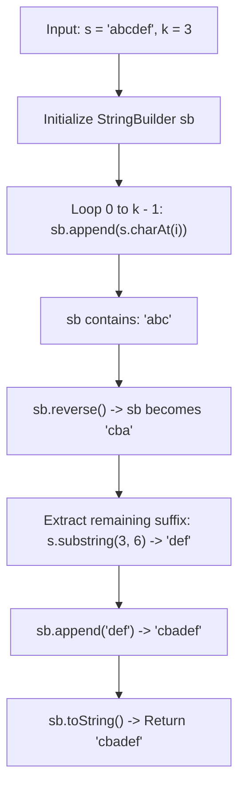

<h2><a href="https://leetcode.com/problems/reverse-string-prefix">3794. Reverse String Prefix</a></h2>

<p>You are given a string <code>s</code> and an integer <code>k</code>.</p>

<p>Reverse the first <code>k</code> characters of <code>s</code> and return the resulting string.</p>

<p>&nbsp;</p>
<p><strong class="example">Example 1:</strong></p>

<div class="example-block">
<p><strong>Input:</strong> <span class="example-io">s = "abcd", k = 2</span></p>

<p><strong>Output:</strong> <span class="example-io">"bacd"</span></p>

<p><strong>Explanation:</strong>​​​​​​​</p>

<p>The first <code>k = 2</code> characters <code>"ab"</code> are reversed to <code>"ba"</code>. The final resulting string is <code>"bacd"</code>.</p>
</div>

<p><strong class="example">Example 2:</strong></p>

<div class="example-block">
<p><strong>Input:</strong> <span class="example-io">s = "xyz", k = 3</span></p>

<p><strong>Output:</strong> <span class="example-io">"zyx"</span></p>

<p><strong>Explanation:</strong></p>

<p>The first <code>k = 3</code> characters <code>"xyz"</code> are reversed to <code>"zyx"</code>. The final resulting string is <code>"zyx"</code>.</p>
</div>

<p><strong class="example">Example 3:</strong></p>

<div class="example-block">
<p><strong>Input:</strong> <span class="example-io">s = "hey", k = 1</span></p>

<p><strong>Output:</strong> <span class="example-io">"hey"</span></p>

<p><strong>Explanation:</strong></p>

<p>The first <code>k = 1</code> character <code>"h"</code> remains unchanged on reversal. The final resulting string is <code>"hey"</code>.</p>
</div>

<p>&nbsp;</p>
<p><strong>Constraints:</strong></p>

<ul>
	<li><code>1 &lt;= s.length &lt;= 100</code></li>
	<li><code>s</code> consists of lowercase English letters.</li>
	<li><code>1 &lt;= k &lt;= s.length</code></li>
</ul>


---

# 🛍️ Reverse-String-Prefix | Explained

## Approach 1: StringBuilder Extraction, Built-in Reverse, and Suffix Concatenation

### Intuition
Imagine a train made of several connected carriages. A station master wants to reverse the order of only the first $k$ carriages while leaving the rest of the train completely undisturbed. To do this, the station master uncouples the first $k$ carriages, drives them onto a turntable to flip their order $180^\circ$, and then couples the undisturbed rear section of the train back onto the newly flipped front carriages.

In string manipulation, Java strings are immutable. By using a mutable container (`StringBuilder`), we isolate the first $k$ characters, flip them using an optimized in-place reversal routine, append the intact tail, and produce the final reassembled string.

### Algorithm Visualized



### Approach
1. **Initialize a Buffer:** Create a `StringBuilder` instance to dynamically accumulate and manipulate characters without creating multiple intermediate immutable `String` objects.
2. **Collect the Prefix:** Iterate from index `0` up to `k - 1` and append each character from `s` to the `StringBuilder`.
3. **Reverse the Prefix:** Call `sb.reverse()`, which flips the accumulated prefix characters in-place inside the buffer using a two-pointer swap internally.
4. **Append the Unmodified Suffix:** Extract the remaining tail of the string starting from index `k` to `s.length()` using `s.substring()` and append it directly to the buffer.
5. **Convert and Return:** Convert the `StringBuilder` back into an immutable `String` via `.toString()` and return it.

### Detailed Code Analysis

```java
1class Solution {
2    public String reversePrefix(String s, int k) {
```
- **Lines 1–2:** Defines the `Solution` class and the `reversePrefix` method. The method accepts the original string `s` and the integer index/length bound `k`, returning the transformed string.

```java
3        StringBuilder sb=new StringBuilder();
```
- **Line 3:** Allocates a new `StringBuilder` instance named `sb`. Because Java's `String` is immutable, any direct concatenation in a loop creates multiple garbage-collected objects. `StringBuilder` provides a resizable `char[]` buffer under the hood, allowing append and reverse operations in-place.

```java
5        for(int i =0;i<k;i++){
6            sb.append(s.charAt(i));
7        }
```
- **Lines 5–7:** A standard counted `for` loop that runs exactly $k$ iterations from index `0` to `k - 1`.
  - In each iteration, `s.charAt(i)` reads the character at index `i` of string `s`.
  - `sb.append(...)` inserts this character at the end of the internal buffer. After this loop terminates, `sb` holds exactly the substring `s[0...k-1]`.

```java
8        sb.reverse();
```
- **Line 8:** Mutates `sb` by reversing its contents. Internally, `StringBuilder.reverse()` uses a two-pointer approach swapping characters from the ends toward the middle in $\mathcal{O}(k)$ time, transforming `s[0...k-1]` into its reverse.

```java
9        sb.append(s.substring(k,s.length()));
```
- **Line 9:** 
  - `s.substring(k, s.length())` extracts the remaining characters of `s` from index `k` up to the end (`s.length() - 1`). Note that `s.substring(k)` is functionally equivalent and more idiomatic.
  - `sb.append(...)` adds this undisturbed tail directly behind the reversed prefix inside `sb`.

```java
10        return sb.toString();
11        
12    }
13}
```
- **Lines 10–13:** `sb.toString()` allocates a new `String` object backed by a copy of `sb`'s underlying character array. This final string is returned to the caller.

### Code
```java
class Solution {
    public String reversePrefix(String s, int k) {
        StringBuilder sb = new StringBuilder();

        for (int i = 0; i < k; i++) {
            sb.append(s.charAt(i));
        }
        sb.reverse();
        sb.append(s.substring(k, s.length()));
        return sb.toString();
    }
}
```

### Complexity
- **Time:** $\mathcal{O}(N)$, where $N$ is the length of the string `s`.
  - Extracting the first $k$ characters takes $\mathcal{O}(k)$ time.
  - Reversing the prefix of length $k$ takes $\mathcal{O}(k)$ operations (roughly $k/2$ swaps).
  - Calling `s.substring(k, s.length())` copies $N - k$ characters, taking $\mathcal{O}(N - k)$ time.
  - Appending the suffix takes $\mathcal{O}(N - k)$ time.
  - Converting the `StringBuilder` to a `String` copies $N$ characters, taking $\mathcal{O}(N)$ time.
  - Total Time: $\mathcal{O}(k) + \mathcal{O}(k) + \mathcal{O}(N - k) + \mathcal{O}(N - k) + \mathcal{O}(N) = \mathcal{O}(N)$.

- **Space:** $\mathcal{O}(N)$.
  - The `StringBuilder` stores up to $N$ characters.
  - The `s.substring(k, s.length())` call creates an intermediate string of size $N - k$.
  - The final `sb.toString()` creates a string of size $N$.
  - Total auxiliary memory allocated is proportional to the size of the input string, giving $\mathcal{O}(N)$ space.

---

## 🕵️‍♂️ Follow-up Questions (Optional)

1. **How can you optimize this solution to avoid creating the intermediate substring object?**
   - Instead of using `s.substring(k, s.length())`, you can convert the entire string into a `char[]` array upfront using `char[] chars = s.toCharArray()`. Then, run a two-pointer swap loop directly between `0` and `k - 1`:
     ```java
     int left = 0, right = k - 1;
     while (left < right) {
         char temp = chars[left];
         chars[left++] = chars[right];
         chars[right--] = temp;
     }
     return new String(chars);
     ```
   - This eliminates multiple heap allocations (`StringBuilder`, intermediate substring) and performs the operation directly on a single character buffer.

2. **What happens if $k > s.\text{length()}$ or $k \le 0$?**
   - If $k > s.\text{length()}$, `s.charAt(i)` at $i = s.\text{length()}$ will throw a `StringIndexOutOfBoundsException`. 
   - A defensive check at the start:
     ```java
     k = Math.min(Math.max(k, 0), s.length());
     ```
     ensures boundary safety across all input values.