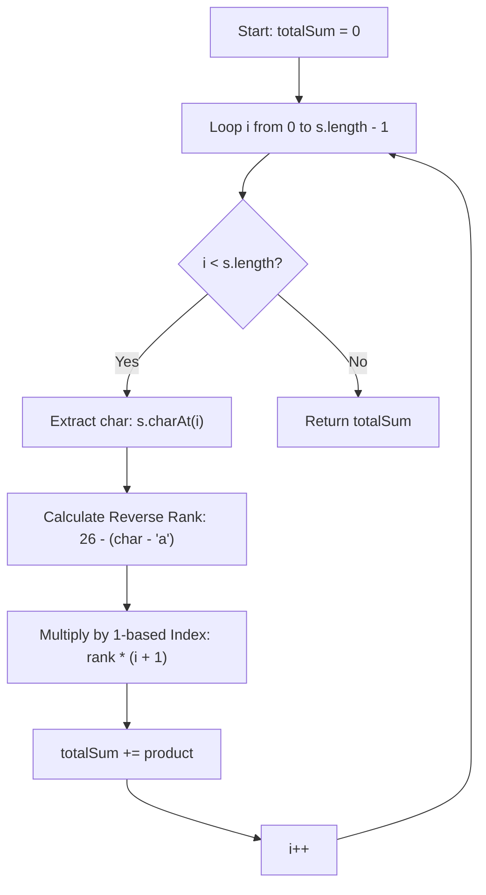

<h2><a href="https://leetcode.com/problems/reverse-degree-of-a-string">3498. Reverse Degree of a String</a></h2>

<p>Given a string <code>s</code>, calculate its <strong>reverse degree</strong>.</p>

<p>The <strong>reverse degree</strong> is calculated as follows:</p>

<ol>
	<li>For each character, multiply its position in the <em>reversed</em> alphabet (<code>'a'</code> = 26, <code>'b'</code> = 25, ..., <code>'z'</code> = 1) with its position in the string <strong>(1-indexed)</strong>.</li>
	<li>Sum these products for all characters in the string.</li>
</ol>

<p>Return the <strong>reverse degree</strong> of <code>s</code>.</p>

<p>&nbsp;</p>
<p><strong class="example">Example 1:</strong></p>

<div class="example-block">
<p><strong>Input:</strong> <span class="example-io">s = "abc"</span></p>

<p><strong>Output:</strong> <span class="example-io">148</span></p>

<p><strong>Explanation:</strong></p>

<table style="border: 1px solid black;"><tbody><tr><th style="border: 1px solid black;">Letter</th><th style="border: 1px solid black;">Index in Reversed Alphabet</th><th style="border: 1px solid black;">Index in String</th><th style="border: 1px solid black;">Product</th></tr><tr><td style="border: 1px solid black;"><code>'a'</code></td><td style="border: 1px solid black;">26</td><td style="border: 1px solid black;">1</td><td style="border: 1px solid black;">26</td></tr><tr><td style="border: 1px solid black;"><code>'b'</code></td><td style="border: 1px solid black;">25</td><td style="border: 1px solid black;">2</td><td style="border: 1px solid black;">50</td></tr><tr><td style="border: 1px solid black;"><code>'c'</code></td><td style="border: 1px solid black;">24</td><td style="border: 1px solid black;">3</td><td style="border: 1px solid black;">72</td></tr></tbody></table>

<p>The reversed degree is <code>26 + 50 + 72 = 148</code>.</p>
</div>

<p><strong class="example">Example 2:</strong></p>

<div class="example-block">
<p><strong>Input:</strong> <span class="example-io">s = "zaza"</span></p>

<p><strong>Output:</strong> <span class="example-io">160</span></p>

<p><strong>Explanation:</strong></p>

<table style="border: 1px solid black;"><tbody><tr><th style="border: 1px solid black;">Letter</th><th style="border: 1px solid black;">Index in Reversed Alphabet</th><th style="border: 1px solid black;">Index in String</th><th style="border: 1px solid black;">Product</th></tr><tr><td style="border: 1px solid black;"><code>'z'</code></td><td style="border: 1px solid black;">1</td><td style="border: 1px solid black;">1</td><td style="border: 1px solid black;">1</td></tr><tr><td style="border: 1px solid black;"><code>'a'</code></td><td style="border: 1px solid black;">26</td><td style="border: 1px solid black;">2</td><td style="border: 1px solid black;">52</td></tr><tr><td style="border: 1px solid black;"><code>'z'</code></td><td style="border: 1px solid black;">1</td><td style="border: 1px solid black;">3</td><td style="border: 1px solid black;">3</td></tr><tr><td style="border: 1px solid black;"><code>'a'</code></td><td style="border: 1px solid black;">26</td><td style="border: 1px solid black;">4</td><td style="border: 1px solid black;">104</td></tr></tbody></table>

<p>The reverse degree is <code>1 + 52 + 3 + 104 = 160</code>.</p>
</div>

<p>&nbsp;</p>
<p><strong>Constraints:</strong></p>

<ul>
	<li><code>1 &lt;= s.length &lt;= 1000</code></li>
	<li><code>s</code> contains only lowercase English letters.</li>
</ul>


---

# 🛍️ Reverse-Degree-of-a-String | Explained

## Approach 1: Single-Pass Linear Accumulation (Direct Positional Weighting)

### Intuition
Imagine a classroom spelling game where letters are assigned points inversely to their standard alphabetical order: `'z'` earns 1 point, `'y'` earns 2 points, and `'a'` earns a maximum of 26 points. Furthermore, the game introduces a position multiplier—the first letter in the word is multiplied by $1$, the second letter by $2$, the third by $3$, and so forth.

Because every character's contribution depends solely on two independent factors—its reverse alphabetical rank and its 1-based index—we do not need to alter or reverse the string itself. We can calculate each character's final weighted score directly on the fly in a single pass.

### Algorithm Visualized



### Approach
1. **Initialize Accumulator:** Create an integer variable `totalSum = 0` to maintain the running total.
2. **Traverse the String:** Iterate sequentially through the string from index `i = 0` to `s.length() - 1`.
3. **Map Character to Reverse Rank:** 
   - Standard 0-indexed alphabetical offset: `s.charAt(i) - 'a'` (where `'a' -> 0`, `'b' -> 1`, ..., `'z' -> 25`).
   - Reverse offset (1-indexed from the end): `26 - (s.charAt(i) - 'a')` (where `'a' -> 26`, `'b' -> 25`, ..., `'z' -> 1`).
4. **Apply Positional Weight:** Multiply the reverse rank by the 1-based index `(i + 1)`.
5. **Accumulate:** Add the resulting product to `totalSum`.
6. **Return Result:** Once the loop completes, return `totalSum`.

### Detailed Code Analysis

```java
class Solution {
    public int reverseDegree(String s) {
        // Line 3: Accumulator variable to hold the aggregate degree value.
        int totalSum = 0;
        
        // Line 4: Standard linear traversal across the string's length.
        // i represents the 0-based index of the current character.
        for (int i = 0; i < s.length(); i++) {
            
            // Line 5: Core computation:
            // 1. `s.charAt(i) - 'a'`: Converts the character into an integer range [0, 25].
            // 2. `26 - (...)`: Inverts the value so 'z' becomes 1 and 'a' becomes 26.
            // 3. `* (i + 1)`: Scales the inverted rank by the 1-based positional multiplier.
            // 4. `totalSum += ...`: Accumulates the value into totalSum.
            totalSum += (26 - (s.charAt(i) - 'a')) * (i + 1);
        }
        
        // Line 9: Returns the final accumulated score.
        return totalSum;
    }
}
```

### Code
```java
class Solution {
    public int reverseDegree(String s) {
        int totalSum = 0;
        for (int i = 0; i < s.length(); i++) {
            totalSum += (26 - (s.charAt(i) - 'a')) * (i + 1);
        }
        return totalSum;
    }
}
```

### Complexity
- **Time Complexity:** $\mathcal{O}(N)$, where $N$ is the length of the string `s`. We iterate through the string exactly once, performing constant time $\mathcal{O}(1)$ arithmetic operations at each step.
- **Space Complexity:** $\mathcal{O}(1)$ auxiliary space. The algorithm uses a fixed number of primitive variables (`totalSum`, `i`) without allocating dynamic memory or modifying the input string.

---

## 🕵️‍♂️ Follow-up Questions (Optional)

1. **What happens if the string is very long (e.g., $N > 10^5$)?**
   - *Answer:* The result can exceed the maximum value of a 32-bit signed integer (`Integer.MAX_VALUE = 2,147,483,647`), causing an arithmetic overflow. For maximum safety when $N$ is large, `totalSum` should be declared as a 64-bit `long`, and the computation cast accordingly:
     ```java
     long totalSum = 0;
     totalSum += (long)(26 - (s.charAt(i) - 'a')) * (i + 1);
     ```

2. **Can this be implemented using Java Streams?**
   - *Answer:* Yes, using `IntStream.range(0, s.length())`:
     ```java
     return java.util.stream.IntStream.range(0, s.length())
         .map(i -> (26 - (s.charAt(i) - 'a')) * (i + 1))
         .sum();
     ```
     While concise, the iterative for-loop approach remains preferred in performance-critical code due to zero boxing/unboxing and function call overhead.