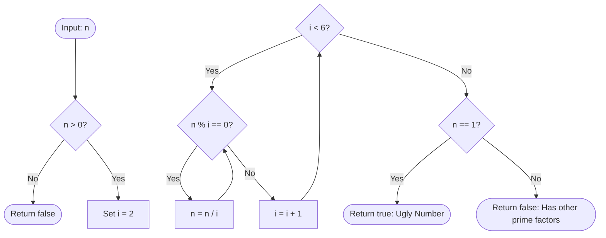

<h2><a href="https://leetcode.com/problems/ugly-number">263. Ugly Number</a></h2>

<p>An <strong>ugly number</strong> is a <em>positive</em> integer which does not have a prime factor other than 2, 3, and 5.</p>

<p>Given an integer <code>n</code>, return <code>true</code> <em>if</em> <code>n</code> <em>is an <strong>ugly number</strong></em>.</p>

<p>&nbsp;</p>
<p><strong class="example">Example 1:</strong></p>

<pre><strong>Input:</strong> n = 6
<strong>Output:</strong> true
<strong>Explanation:</strong> 6 = 2 × 3
</pre>

<p><strong class="example">Example 2:</strong></p>

<pre><strong>Input:</strong> n = 1
<strong>Output:</strong> true
<strong>Explanation:</strong> 1 has no prime factors.
</pre>

<p><strong class="example">Example 3:</strong></p>

<pre><strong>Input:</strong> n = 14
<strong>Output:</strong> false
<strong>Explanation:</strong> 14 is not ugly since it includes the prime factor 7.
</pre>

<p>&nbsp;</p>
<p><strong>Constraints:</strong></p>

<ul>
	<li><code>-2<sup>31</sup> &lt;= n &lt;= 2<sup>31</sup> - 1</code></li>
</ul>


---

# 🛍️ Ugly-Number | Explained

## Approach 1: Iterative Prime Factor Reduction (Trial Division)

### Intuition
An **ugly number** is defined as a positive integer whose prime factors are strictly limited to `2`, `3`, and `5`. By definition, any positive integer $n$ can be expressed by the Fundamental Theorem of Arithmetic as:

$$n = 2^a \times 3^b \times 5^c \times k$$

Where $k$ represents the product of all other prime factors (such as $7, 11, 13, \dots$). If a number is an ugly number, $k$ must equal $1$.

Think of this like an industrial sorting machine equipped with three specific filter sieves sized for particles 2, 3, and 5. You dump the number into the machine. The machine repeatedly strips away every factor of 2, then every factor of 3, and finally every factor of 5. If the original material was composed *exclusively* of these elements, you will be left with an irreducible base unit of `1`. If any foreign particle (a prime factor $\ge 7$) exists, it will fail to pass through the sieves and remain in the container, leaving a final value greater than `1`.

### Algorithm Visualized



### Approach
1. **Guard Against Non-Positive Inputs**: Non-positive numbers ($\le 0$) cannot be ugly numbers by definition. The loop condition `n > 0` immediately halts execution if a non-positive integer is supplied.
2. **Exhaustive Factor Stripping**:
   - Iterate through potential divisors $i \in \{2, 3, 4, 5\}$.
   - For each factor $i$, enter a `while` loop that continually divides $n$ by $i$ as long as $n$ is divisible by $i$ (`n % i == 0`).
   - *Note on $i = 4$*: Since all factors of `2` are fully eliminated during the first iteration ($i = 2$), $n$ will no longer be divisible by `4`. Thus, the loop at $i = 4$ is a harmless $O(1)$ no-op check, avoiding the need for a separate custom array of primes.
3. **Validation**:
   - After stripping factors of 2, 3, and 5, inspect the remaining value of $n$.
   - If $n == 1$, all prime factors were exclusively 2, 3, or 5.
   - If $n > 1$, the remaining value represents one or more prime factors outside the allowed set (e.g., $7, 11$).

### Detailed Code Analysis

```java
class Solution {
    public boolean isUgly(int n) {
        // Line 3: Iterate through candidate factors 2, 3, 4, and 5.
        // The condition 'n > 0' guards against 0 and negative inputs,
        // preventing infinite loops and handling invalid cases immediately.
        for (int i = 2; i < 6 && n > 0; i++){
            
            // Lines 4-5: Repeatedly divide n by factor i until it is no longer divisible.
            // When i = 2: strips 2^a.
            // When i = 3: strips 3^b.
            // When i = 4: n % 4 is false because all factors of 2 were already removed.
            // When i = 5: strips 5^c.
            while (n % i == 0)
                n /= i;
        }
        
        // Line 7: If all prime factors were strictly 2, 3, and 5,
        // n will be reduced entirely to 1.
        // If n <= 0 initially, or if n contained other prime factors (e.g., 7, 13),
        // n will not equal 1, correctly returning false.
        return n == 1;
    }
}
```

### Code
```java
class Solution {
    public boolean isUgly(int n) {
        for (int i = 2; i < 6 && n > 0; i++){
            while (n % i == 0)
                n /= i;
        }
        return n == 1;
    }
}
```

### Complexity
- **Time Complexity:** $\mathcal{O}(\log n)$
  - In each step of the inner `while` loop, $n$ is divided by at least `2`.
  - The maximum number of divisions is bounded by $\log_2(n) + \log_3(n) + \log_5(n) \approx 1.58 \log_2(n) = \mathcal{O}(\log n)$.
  - For a 32-bit signed integer, the maximum number of divisions will never exceed $\approx 31$ operations, making this practically $\mathcal{O}(1)$ runtime in practice.
- **Space Complexity:** $\mathcal{O}(1)$
  - Memory consumption is purely static. Only a single primitive loop counter `i` is allocated on the stack. No heap allocation or recursive frames are created.

---

## 🕵️‍♂️ Follow-up Questions (Optional)

1. **How do you generate the $N$-th Ugly Number instead of just checking validity (LeetCode 264: Ugly Number II)?**
   - *Answer*: Trial division becomes too slow ($O(K \log K)$ where $K$ is the $N$-th ugly number). Instead, use a **Dynamic Programming / 3-Pointer Approach** or a **Min-Heap**. Maintain three pointers ($p_2, p_3, p_5$) tracking the smallest ugly number to multiply by 2, 3, and 5 next, yielding an optimal $\mathcal{O}(N)$ time and $\mathcal{O}(N)$ space solution.

2. **What if the allowed prime factors are dynamic (e.g., given an arbitrary array of $k$ primes as in "Super Ugly Number")?**
   - *Answer*: Generalize the 3-pointer DP approach to a $k$-pointer approach using a **Priority Queue (Min-Heap)** storing tuples of `(next_multiple, prime_value, pointer_index)`. This reduces the transition time to find the next minimum from $\mathcal{O}(k)$ to $\mathcal{O}(\log k)$, achieving $\mathcal{O}(N \log k)$ overall time.